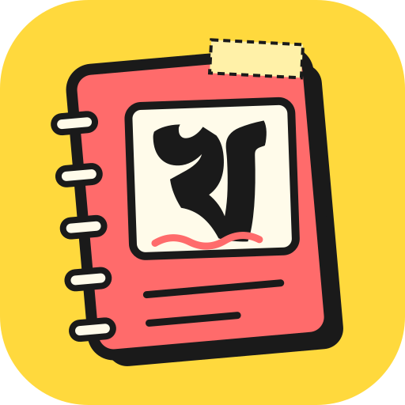

<p align="center">
  
</p>

<h1 align="center">Khata <small>খাতা</small></h1>

<p align="center"><b>A notebook-style word processor.</b><br>
Write, doodle and keep everything in one <i>khata</i> (খাতা: Bengali for notebook or ledger).</p>

---

Khata is a free, open-source word processor written in Rust. It opens and saves `.docx`, exports PDF,
runs on the desktop (Windows, macOS, Linux) and in the browser (WebAssembly), and ships a CLI and an
MCP server so an AI agent can edit documents too.

It is a **fork of [WordCraft](https://github.com/storytold/wordcraft)** by the ArtCraft Team, re-skinned
and extended by [NH Prince Pradhan](https://nhprince.me). All the document engine work is theirs; see
[Credits](#credits-and-license).

<p align="center">
  <a href="https://github.com/nhprince/khata/releases/latest"><b>Download</b></a> ·
  <a href="https://nhprince.github.io/khata/"><b>Try it in your browser</b></a> ·
  <a href="https://github.com/nhprince/khata/actions/workflows/ci.yml">CI</a>
</p>

## What Khata changes

- **Scrapbook theme.** Cream paper, marker-pen outlines, hard yellow sticker shadows, washi tape on
  the template cards, a sticky-note active tab, a dotted bullet-journal canvas and hand-lettered
  headings (Caveat Brush, Patrick Hand, Kalam). A matching dark "night notebook" theme is included.
- **A real shapes gallery.** Insert › Shapes is a categorized gallery of drawn thumbnails (Recently
  Used, Lines, Rectangles, Basic Shapes, Block Arrows, Equation Shapes, Flowchart, Stars and Banners,
  Callouts) with about 70 shapes, instead of a plain text list. Shapes without a native kind are
  inserted as editable freeforms.
- **Simple mode by default.** The ribbon starts with the tabs most people use. The advanced tabs
  (Draw, Mailings, Developer, Zotero) come back with *File › Options › General › Show advanced tabs*.
- **Khata branding.** New name, logo and icons, Bengali-aware interface fonts (Atma) and no
  third-party community links.

## Install

Grab the installer for your system from the [latest release](https://github.com/nhprince/khata/releases/latest): Windows `.msi` (or portable `.zip`), macOS `.dmg`, Linux `.AppImage`, `.deb`, `.rpm` or `.tar.gz`. Or open the [live demo](https://nhprince.github.io/khata/) in your browser. Releases are built automatically; see [`docs/releasing.md`](docs/releasing.md).

## Build from source

You need Rust 1.95 or newer.

```sh
cargo run --release -p khata -- --sample        # the desktop app with the sample document
cargo run --release -p khata -- report.docx     # open a document
```

Web build: `cd apps/khata-web && trunk serve`, then open <http://127.0.0.1:8771/?sample>.

CLI and MCP server for agents:

```sh
cargo run --release -p khata-cli -- --help
```

Checks: `cargo xtask ci` (formatting, clippy, tests, the asset-attribution check and layering rules).

## Project layout

| Path | What |
|---|---|
| `crates/doc` | Document model, including the preset shape geometry (`shape_presets.rs`) |
| `crates/engine` | Commands, layout, editing |
| `crates/ui-egui` | The interface: `theme.rs` holds the scrapbook palette, fonts and painting helpers |
| `apps/khata` | Desktop app |
| `apps/khata-web` | Browser build |
| `packaging/` | Installers (WiX, DMG, Flatpak, deb/rpm) |

More detail in [`docs/architecture.md`](docs/architecture.md).

## Credits and license

Khata is dual-licensed under **MIT OR Apache-2.0** (see `LICENSE-MIT` and `LICENSE-APACHE`).

- Document engine, UI framework and most of the code: © 2026 ArtCraft Team and the WordCraft
  contributors, from [storytold/wordcraft](https://github.com/storytold/wordcraft).
- Khata changes (theme, shapes gallery, simple mode, branding): © 2026 NH Prince Pradhan.
- Fonts: Patrick Hand, Kalam, Caveat Brush and Atma are under the SIL Open Font License; the license
  texts are in `assets/fonts/`.
- Third-party assets are listed in [`ATTRIBUTION.md`](ATTRIBUTION.md); upstream attribution notices are
  in [`NOTICE`](NOTICE).

"Microsoft" and "Word" are trademarks of Microsoft Corporation. Khata is not affiliated with or
endorsed by Microsoft.
