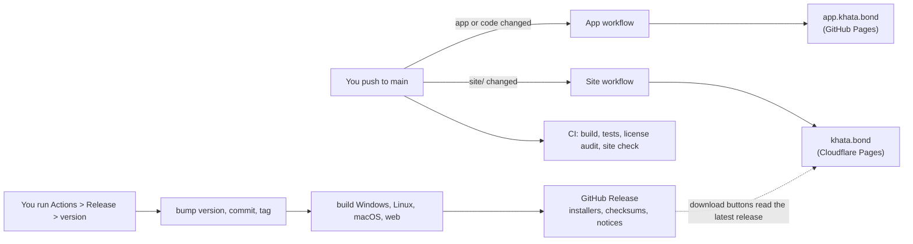

# How Khata runs: the day-to-day flow and what is automatic

## The big picture

| Address | What | Updated |
|---|---|---|
| https://khata.bond | the landing page (`site/`) | on every push that changes `site/` (about 1 minute) |
| https://app.khata.bond | the web app | on every push that changes the app or the code it is built from (about 8 minutes) |
| GitHub Releases | installers for Windows, macOS and Linux | when you run **Release** |
| the download buttons on khata.bond | links to the latest release | automatically, see below |

## Everyday work

1. Change code or content, commit, push to `main`.
2. Open the *Actions* tab. What runs depends on what you changed:

| You changed | Workflows that run |
|---|---|
| anything | **CI** (`ci.yml`): compile, tests, dependency-license audit, website check |
| `Cargo.*`, `apps/khata*`, `crates/ui-egui/**` | also **Printing** (upstream's `printing.yml`): strict clippy, tests on Windows, macOS and Linux, browser (wasm) build check |
| `site/**` | **Site** (`site-landing.yml`): checks the site, deploys it to Cloudflare Pages, tests the deployment |
| `apps/khata-web`, `crates/**`, `assets/**`, `packaging/web`, `Cargo.*` | **App** (`site-app.yml`): builds the web app and deploys it to GitHub Pages |
| `flake.*` | **Nix** (upstream) |

3. A red cross on a run means something needs a look. The run's *Summary* page and the failing step's log
   say why. Fix it, push again.

Good commit messages matter: they become the release notes (next section).

## Making a release

1. **Actions › Release › Run workflow.** Type the new version (for example `0.2.0`), run it on `main`.
   (Leave the box empty for a dry run: everything is built and attached to the run, nothing is published.)
2. The workflow bumps the version in `Cargo.toml` and `Cargo.lock`, commits `Release v0.2.0`, tags it, builds
   everything in parallel (Windows, Linux, macOS, web), and publishes the GitHub Release with the installers,
   `SHA256SUMS.txt`, `THIRD_PARTY_LICENSES.txt` and a change list from your commit messages.
3. Windows and Linux are required; macOS and the web zip are best effort. If one of those fails, the release still
   goes out and the run shows which one to look at.
4. **Nothing else to do.** The website's download buttons read the latest release when a visitor opens the page
   (from GitHub's public API, remembered for 10 minutes in the visitor's browser), so the new version and the new
   file links appear by themselves. No website deploy is needed. Until your first release exists, the buttons
   link to the releases page. Pre-releases (such as `0.2.0-beta.1`) are not "latest", so the buttons keep showing the
   last full release.

The web app at app.khata.bond follows `main`, not the releases: it shows the newest code as soon as you push,
while the installers are the stable, numbered versions. (If you would rather have it change only on releases,
say so; the trigger of `site-app.yml` is the one line to change.)

## What exists outside the repository (set once, then left alone)

| Where | What |
|---|---|
| GitHub › Settings › Secrets and variables › Actions | secrets `CLOUDFLARE_API_TOKEN` and `CLOUDFLARE_ACCOUNT_ID` (optional variable `CLOUDFLARE_PROJECT`) |
| GitHub › Settings › Pages | source **GitHub Actions**, custom domain `app.khata.bond`, **Enforce HTTPS** on |
| Cloudflare › DNS | `CNAME app → nhprince.github.io` (grey cloud); the email-routing MX/TXT records; the `khata.bond` and `www` records that Cloudflare Pages manages itself |
| Cloudflare › Workers & Pages › khata › Custom domains | `khata.bond` and `www.khata.bond` |
| Your domain registrar | the `khata.bond` registration (see below) |

## Routine maintenance

- **Monthly:** Dependabot opens one pull request that updates the GitHub Actions used by the workflows. If **CI**
  is green, merge it.
- **Domain renewal:** `khata.bond` expires if you do not renew it. Turn on auto-renew at your registrar and note
  the expiry date.
- **Cloudflare API token:** if you gave it an expiry date, create a new one before then and replace the
  `CLOUDFLARE_API_TOKEN` secret. If the token stops working, the site workflow fails with an authentication error.
- **Runners and tools:** the workflows use pinned runner images (Ubuntu 24.04 and 22.04) and the stable Rust
  toolchain. When GitHub retires an image or Rust adds new lints, a run goes red with a clear message; fix and push.
- **Upstream WordCraft:** Khata is a fork whose names were all changed, so merging upstream wholesale would
  conflict almost everywhere. Look at upstream's changes now and then and port the ones you want by hand.

## Where to look when something is wrong

| Symptom | Look at |
|---|---|
| The website did not update | Actions › **Site** run: did the "Check the site" or the deploy step fail? Were the Cloudflare secrets set? |
| The web app did not update | Actions › **App** run (the build takes about 8 minutes); then GitHub › Settings › Pages |
| A release is missing a platform | the **Release** run: the red job names it; its log has the cause |
| The download buttons show the releases page | no full release published yet, or GitHub's API is busy; reload later |
| `khata.bond` or `app.khata.bond` does not load | `docs/hosting.md` (DNS and certificate troubleshooting) |
| A pull request or push fails the license audit | `python3 packaging/third-party-licenses.py --check` names the dependency |

More detail: `docs/releasing.md` (releases), `docs/hosting.md` (domains), `docs/licensing.md` (legal).
