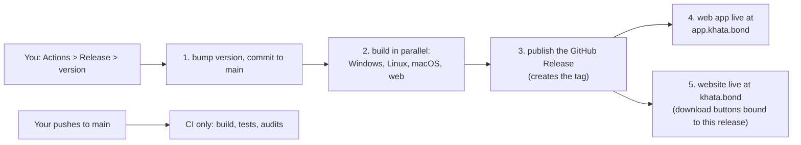

# How Khata runs: one action does everything

The only thing you do to ship is **Actions › Release › Run workflow** and type a version. Everything else
(installers, the web app, the website, its download buttons) follows by itself, from the same commit.

| What | Where | Changes when |
|---|---|---|
| Installers (Windows, macOS, Linux) | GitHub Releases | you run **Release** |
| Web app | https://app.khata.bond | you run **Release** (same build as the release's web zip) |
| Website + download buttons | https://khata.bond | you run **Release** (or the manual "Site" run below) |
| Code on `main` | GitHub | you push; only **CI** runs |

So a normal push never changes anything people can see: the live app and the downloads are always a
numbered release and always match each other.

## Making a release

1. **Actions › Release › Run workflow**, branch `main`, version `0.2.0` (no leading `v`). Real releases are only
   accepted from `main`. Leave the version empty for a **dry run** (builds everything, publishes and deploys nothing);
   a dry run is allowed from any branch.
2. Watch the run. Its **Summary** page ends with a table: each platform, the published release, the app, the
   website.
3. That is all. A version with a suffix (`0.2.0-beta.1`) is published as a **pre-release** and leaves the live
   app and website alone.

What the workflow does, in order:

1. **prepare:** sets the version in `Cargo.toml`/`Cargo.lock`, commits `Release v0.2.0` to `main` (no tag yet).
2. **build:** Windows (MSI + portable zip), Linux (AppImage, deb, rpm, tar.gz), macOS (dmg) and the web app, all
   from that commit. Windows, Linux and web are required (a release exists for every platform or not at all); macOS
   is best effort.
3. **release:** writes `SHA256SUMS.txt` and `THIRD_PARTY_LICENSES.txt`, builds the change list from your commit
   messages since the previous release, creates the GitHub Release as a **draft**, uploads every file to it, and only
   then **publishes** it, which is the moment the tag `v0.2.0` is created. So a failed upload can never leave a
   half-published release.
4. **pages:** deploys the web app build to GitHub Pages (app.khata.bond).
5. **site:** calls `site-landing.yml`, which writes `release.json` (version + exact download links of this
   release), checks the site, deploys it to Cloudflare Pages (khata.bond) and smoke-tests the deployment.
6. **report:** the summary table.

**If a release fails** before step 3 finishes, nothing was tagged or published (at most an unpublished *draft*
release exists: delete it under Releases before re-running). Fix the problem, push, and run **Release** again with
the *same* version (the version commit is already there and is not repeated). If only step 4 or 5 fails after the
release was published, press *Re-run failed jobs* on that run.

**Manual tag instead of the button:** `cargo xtask version set 0.2.0`, commit, `git tag v0.2.0`, `git push --tags`
runs the same pipeline, but GitHub's `github-pages` environment normally refuses deployments from tags, so
add the pattern `v*` under *Settings › Environments › github-pages › Deployment branches and tags* first.
The button is simpler.

## What each workflow does

| Workflow | When it runs | What it does |
|---|---|---|
| `release.yml` | you start it (or push a `v*` tag) | the pipeline above |
| `site-landing.yml` ("Site") | called by Release; or by hand | checks and deploys `site/` to Cloudflare Pages, bound to a release |
| `site-app.yml` ("App") | by hand only | redeploys the web app of the **latest release** (or a tag you type); for recovery |
| `ci.yml` | every push and pull request | compile, tests, dependency-license audit, website check |
| `printing.yml`, `nix.yml` | upstream's, on matching file changes | strict lint and tests on Windows/macOS/Linux; Nix evaluation |
| Dependabot | monthly | one pull request updating the GitHub Actions |

## Changing the website without a release

Edit `site/`, push, then **Actions › Site (khata.bond) › Run workflow**. It deploys the current branch with the
latest release's download links (about a minute). A push alone does not deploy; the next release will include it.

## What exists outside the repository (set once)

| Where | What |
|---|---|
| GitHub › Settings › Secrets and variables › Actions | secrets `CLOUDFLARE_API_TOKEN` and `CLOUDFLARE_ACCOUNT_ID` (optional variable `CLOUDFLARE_PROJECT`) |
| GitHub › Settings › Pages | source **GitHub Actions**, custom domain `app.khata.bond`, **Enforce HTTPS** |
| Cloudflare › DNS | `CNAME app → nhprince.github.io` (grey cloud); the email-routing MX/TXT records; the records Cloudflare Pages manages for `khata.bond` and `www` |
| Cloudflare › Workers & Pages › khata › Custom domains | `khata.bond` and `www.khata.bond` |
| Your domain registrar | the `khata.bond` registration |

## Routine maintenance

- **Monthly:** merge Dependabot's pull request when **CI** is green.
- **Domain:** turn on auto-renew for `khata.bond` and note the expiry date.
- **Cloudflare token:** if it has an expiry date, replace the `CLOUDFLARE_API_TOKEN` secret before then.
- **Runners and tools:** workflows use pinned runner images (Ubuntu 24.04 and 22.04) and stable Rust; when GitHub
  retires an image or Rust adds new lints, a run goes red with a clear message.
- **Upstream WordCraft:** all names were changed, so merging upstream wholesale would conflict almost everywhere;
  look at their changes now and then and port the ones you want by hand.

## Where to look when something is wrong

| Symptom | Look at |
|---|---|
| A release failed | the run's Summary table, then the red job's log; fix, push, run **Release** again with the same version |
| Release published but the app is old | the run's `pages` job; or run **App** by hand |
| Release published but the website buttons are old | the run's `site` job; or run **Site** by hand (the Cloudflare secrets must exist) |
| The download buttons show the releases page | no full release yet, or `release.json` missing; run **Site** once |
| `khata.bond` or `app.khata.bond` does not load | `docs/hosting.md` (DNS and certificate troubleshooting) |
| The license audit fails | `python3 packaging/third-party-licenses.py --check` names the dependency |

More detail: `docs/releasing.md`, `docs/hosting.md`, `docs/licensing.md`.

## What happens in tricky situations

| Situation | What happens |
|---|---|
| You push to `main` while a release is running | Nothing special: the release builds the commit it started from. Your push only runs CI. |
| You start a second release while one is running | It waits (one release at a time) and starts when the first run, including its deployments, has finished. |
| `main` moves right as the version commit is pushed | The push is retried once after a rebase; if that conflicts, the run stops with a Git error and you run it again. |
| A required build (Windows, Linux, web) fails | No release is published and nothing is tagged; the Summary table shows which job failed. |
| The macOS build fails | The release still goes out without the `.dmg`; the Summary says so. |
| Uploading release files fails | Only a draft exists, nothing is public. Delete the draft and run again. |
| The release is published but the app or website deployment fails | The release is fine; re-run the failed jobs. The older app/website stays live meanwhile. |
| Cloudflare secrets are missing | The website step is skipped with a notice (the Summary says "not deployed"), the release is unaffected. |
| You release a pre-release (`1.0.0-beta.1`) | Published as a pre-release; the live app and website are not touched. |
| You release the same version twice | The second run is refused (the tag exists). |
| You start a release from another branch | Refused; use an empty version for a dry run there. |
| You run the "App" workflow by hand during a release | It waits for the release's app deployment (they share a lock). |
| GitHub's API is rate-limiting visitors | The website reads its own `release.json`, so it does not depend on the API. |
